# Awesome-LLM-Evaluation-Testing

 

> **The best LLM evaluation tools and LLM testing frameworks, curated in one list** — 40+ open-source LLM evaluators, RAG evaluation libraries, prompt testing tools, agent evaluation frameworks and LLM observability platforms, each with pricing, free-tier limits and live star counts.

## Top LLM Evaluation & Testing Ecosystem

📚 **Curated List of SaaS Products & Open-Source GitHub Projects**

*Focused on Prompt Regression Testing, RAG Evaluation & Agent Observability*

📅 **Last updated: March 2026**

If you are comparing **LLM evaluation tools**, **LLM testing frameworks**, **RAG evaluation metrics** or **LLM observability platforms**, this list is built for you: it tracks notable **SaaS platforms** and **open-source projects** for **LLM Evaluation & Testing**. These tools measure output quality, detect hallucinations, catch prompt regressions, evaluate RAG pipelines, red-team for safety vulnerabilities, and monitor agent behavior in production.

🎯 **Examples** include Patronus AI, DeepEval, Ragas Cloud, TruLens, Confident AI, Braintrust, Galileo, Arthur AI, Fiddler AI, and Scale AI (the category leaders).

🔓 **Open-source emphasis**: This section is heavily expanded with every major active project for self-hosting, CI/CD integration, and transparent evaluation pipelines — ideal for AI engineers, researchers, and teams building vendor-neutral evaluation infrastructure.

🎉 Contributions welcome! Open a PR to add/update entries. Keep descriptions factual and link to official sites.

## 📋 Table of Contents

- [🌍 Sector Overview & Market Dynamics](#sector-overview--market-dynamics)

- [💼 SaaS/Hosted Platforms](#saas-hosted-platforms)
- [🔓 Open-Source GitHub Projects](#open-source-github-projects)- [🤝 How to Contribute](#how-to-contribute)

- [❓ Frequently Asked Questions](#frequently-asked-questions)

- [⚠️ Disclaimer](#disclaimer)

## 🌍 Sector Overview & Market Dynamics

📊 **Estimated market size:** The LLM evaluation platform market was worth roughly **$2.4 billion in 2025** and is forecast to hit **$18.7 billion by 2034 (25.6% CAGR)**; the neighbouring AI-observability segment is estimated at **$1.4–1.8 billion in 2026**, eying **$13.9–16.1 billion by the mid-2030s**. Analyst definitions differ, so read those as a range rather than one consensus number.

🧩 **Market structure: moderately fragmented — not winner-take-all.** There is no dominant leader: 20+ specialist evaluation and observability vendors coexist with general-purpose incumbents (Datadog, New Relic, Grafana) and platform entrants (LangSmith, Databricks), share data is unpublished, and consolidation is only now starting (CoreWeave→Weights & Biases 2025, ClickHouse→Langfuse 2026, Cisco→Galileo 2026) — a fragmented field with deep-pocketed buyers, so multi-vendor and open-source adoption remain the norm.

## 💼 SaaS/Hosted Platforms

💰 Prices below are the **lowest publicly listed paid tier** (USD, as published on each vendor's own pricing page or marketplace listing); free-tier figures are the documented **free-for-ever** quotas, or the trial length where only a trial exists. **Rows are sorted by company size (descending)**, using the most recent disclosed valuation and falling back to the latest funding round or estimated revenue where no valuation is public.

| Product | Company size (valuation / revenue) | What it does | Pricing (starting paid tier) | Free tier / trial limits |
|---|---|---|---|---|
| 💼 *[Scale AI](https://scale.com/)** | **≈$29B valuation (2025**, Meta-led round); **$870M revenue (2024)** | Data labeling and model evaluation platform with human-in-the-loop feedback for LLM quality assurance. | **$1,000,000/month Scale GenAI Platform Fee** listed on AWS Marketplace (enterprise contract entitlement + token units); Scale Rapid self-labeling is **$0.05 per labeling unit** after the free allowance. | **Free forever: 200 Rapid labeling units/month** (~$10 of unit value), then $0.05/unit. No free tier or trial days are published for Data Engine / evaluation offerings (demo-led sales). |
| 💼 *[Braintrust](https://www.braintrust.dev/)** | **$800M valuation (2026)** after an $80M Series B | Enterprise AI evaluation platform with code-defined eval pipelines, CI/CD integration that blocks sub-threshold changes, and no per-seat pricing. | **Pro: $249/month** (usage-based data processing with no per-seat charge). | **Starter: free forever** — 1 GB processed data/month, 10K scores/month, 14-day retention, **$10/month in model credits**, unlimited users/projects/datasets/experiments. |
| 💼 *[Arthur AI](https://www.arthur.ai/)** | **$250–500M valuation (2022**, Dealroom range); **$1–10M revenue (latest FY)** | Model monitoring and evaluation platform with fairness, bias, and performance tracking across the ML lifecycle. | **Premium: $60/month** (self-serve, billed per workspace). | **Free forever**: up to **4 use cases**, unlimited seats, 1 org, 1 workspace, 2 projects, 7-day retention — **5K jobs, 300K spans, 12K inferences, 3K evals** per month. |
| 💼 *[Fiddler AI](https://www.fiddler.ai/)** | **$100–250M valuation (2026**, Dealroom range); **$1–10M revenue (latest FY)** | AI observability and explainability platform for model monitoring, drift detection, and governance. | **$24,000 per 12-month contract (≈$2,000/month)** for the AWS Marketplace Lite listing — 1 model, 0.5 GB data/month. | **30-day free trial** via AWS SageMaker Partner AI App: full functionality for **up to 5 models**, zero licence fee (AWS infrastructure costs still apply); no free-for-ever plan is published. |
| 💼 *[Patronus AI](https://www.patronus.ai/)** | **$50M raised — Series B (Jun 2026)**; valuation not disclosed | Automated LLM evaluation and testing platform with proprietary evaluator models for hallucination detection, safety, and RAG quality. | **$10 per 1,000 small-evaluator calls / $20 per 1,000 large-evaluator calls** on the self-serve evaluation API; enterprise dashboard plans are quote-priced (no public list price). | **$5 one-time free credits** at API signup (≈500 small-evaluator calls); grants do not expire on a published schedule. No time-limited trial of the enterprise platform is published. |
| 💼 *[Galileo](https://galileo.ai/)** | **Acquired by Cisco (Aug 2026**, price undisclosed); **$45M Series B (Oct 2024)** | AI evaluation and guardrails platform with named agentic metrics (Tool Selection Quality, Action Completion, Reasoning Coherence) powered by Luna-2 small models at sub-200ms latency. Since Aug 2026 the product ships as **Splunk Agent Observability** after Cisco's acquisition. | **Pro: $100/month for 50K traces** (last standalone Galileo list price; post-acquisition Splunk SKUs are quoted, bundled with Splunk ARR). | **Free forever: 5,000 traces/month** on the standalone Galileo Free plan; no trial days are published for the successor Splunk Agent Observability SKU. |
| 💼 *[Confident AI](https://www.confident-ai.com/)** | **≈$550K estimated revenue (2025)**; valuation not disclosed | Cloud platform for DeepEval with evaluation result logging, LLM tracing, dataset management, and production monitoring. | **Starter: $200/month per organization** (unlimited seats, up to 5 projects). | **Free forever**: 2 seats, 1 project, **5 test runs/week**, 1 GB-month of trace data, 1-week retention. |
| 💼 *[Ragas Cloud](https://www.ragas.io/)** | **≈$330K estimated revenue (2025)**; Y Combinator-backed | Managed evaluation service for RAG pipelines built on the open-source Ragas framework, with hosted dashboards and continuous monitoring. | **$0 for the self-hosted OSS framework (Apache-2.0)**; the hosted Ragas Cloud/enterprise offer has **no published list price** — it is sold via quote. | **Free forever**: the full OSS framework with unlimited local metrics, datasets and runs (you only pay your own judge-model API bills). No hosted free plan and no trial days are published for Ragas Cloud. |

## 🔓 Open-Source GitHub Projects

⭐ Every repository below carries a live **star badge** (`style=social`, white) that links straight to its own stargazers page, and the list is sorted by **star count, descending** (star counts move, so the badges are the source of truth).

- 🧰 *[Langfuse](https://github.com/langfuse/langfuse)** 
  Open-source LLM observability and evaluation platform with managed LLM-as-judge, annotation queues, and prompt experiments. MIT licensed and self-hostable .

- 🧰 *[Promptfoo](https://github.com/promptfoo/promptfoo)** 
  **The leading developer-first CLI and library for LLM evaluation and red teaming** — MIT licensed. Declarative YAML configs, 100% local evals (prompts never leave your machine), model comparison across GPT/Claude/Gemini/Llama, CI/CD integration, and vulnerability scanning for prompt injection and jailbreaks .

- 🧰 *[Opik](https://github.com/comet-ml/opik)** 
  Comet's open-source LLM evaluation suite — trace logging, **metric libraries for hallucination/contamination/PII**, production and offline monitoring, and a Docker-compose self-host stack .

- 🧰 *[OpenAI Evals](https://github.com/openai/evals)** 
  OpenAI’s framework and registry of LLM evals — the capability and safety suites behind the original GPT-3/GPT-4 releases, plus a simple YAML/Python format for authoring your own regression tests .

- 🧰 *[DeepEval](https://github.com/confident-ai/deepeval)** 
  **Pytest-style unit testing framework for LLM outputs** — G-Eval, hallucination, answer relevancy, faithfulness, contextual precision/recall, and RAGAS metrics running locally. Red-team 40+ safety vulnerabilities, benchmark on MMLU/HellaSwag/TruthfulQA, and create custom metrics .

- 🧰 *[Ragas](https://github.com/explodinggradients/ragas)** 
  **Research-backed RAG evaluation toolkit** — objective metrics (faithfulness, answer relevance, context precision/recall), intelligent test data generation, and seamless LangChain/LlamaIndex integration .

- 🧰 *[lm-evaluation-harness](https://github.com/EleutherAI/lm-evaluation-harness)** 
  The de-facto standard harness for benchmarking LLMs on MMLU, HellaSwag, ARC, TruthfulQA and hundreds more, with a task-config system that powers the Open LLM Leaderboard .

- 🧰 *[Arize Phoenix](https://github.com/Arize-ai/phoenix)** 
  Open-source LLM tracing and evaluation with OpenTelemetry trajectory-span analysis and Trajectory Mapping for agent loop detection .

- 🧰 *[Promptflow](https://github.com/microsoft/promptflow)** 
  Microsoft’s LLMOps toolkit for building, testing and versioning LLM flows, with integrated eval runs and CI/CD quality gates (now part of Azure AI Foundry) .

- 🧰 *[Evidently](https://github.com/evidentlyai/evidently)** 
  Python library for evaluating, testing and monitoring ML and LLM systems — data/text drift, LLM evals and HTML reports you can wire into a regression pipeline .

- 🧰 *[Guardrails AI](https://github.com/guardrails-ai/guardrails)** 
  Declarative validation and structured-output-repair framework for LLM responses, with hub-contributed rails for factuality, PII, toxicity and format enforcement .

- 🧰 *[Traceloop / OpenLLMetry](https://github.com/traceloop/openllmetry)** 
  OpenTelemetry-native LLM application monitoring and evaluation .

- 🧰 *[NVIDIA NeMo Guardrails](https://github.com/NVIDIA/NeMo-Guardrails)** 
  Runtime guardrails framework for fact-checking, grounding, dialogue control and content safety around LLM apps .

- 🧰 *[Helicone](https://github.com/Helicone/helicone)** 
  Open-source LLM proxy that records every request and gives cost, latency and token dashboards plus prompt-comparison scoring for iteration .

- 🧰 *[Giskard](https://github.com/Giskard-AI/giskard)** 
  Open-source AI quality testing for bias detection, robustness testing, and explainability across ML models and LLM applications .

- 🧰 *[TruLens](https://github.com/truera/trulens)** 
  **OpenTelemetry-native evaluation and tracing framework** — RAG Triad metrics (groundedness, answer relevance, context relevance), agentic evaluators, and export to any OTLP backend (Jaeger, Grafana Tempo, Datadog). Completely free and self-hosted .

- 🧰 *[EvalScope](https://github.com/modelscope/evalscope)** 
  ModelScope’s all-in-one toolkit for evaluating LLMs and VLMs — benchmark suites (MMLU, C-Eval, GSM8K), multi-turn and tool-call evals, and model deep-dive reports .

- 🧰 *[Laminar](https://github.com/lmnr-ai/lmnr)** 
  Open-source AI agent observability with trace workflows, agent run replay, and anomaly detection .

- 🧰 *[Inspect](https://github.com/UKGovernmentBEIS/inspect_ai)** 
  UK AI Safety Institute framework for LLM evaluations supporting ReAct, Deep Agent, and custom multi-agent architectures with first-class tool use .

- 🧰 *[OpenLIT](https://github.com/openlit/openlit)** 
  OpenTelemetry-native LLMOps platform with evaluation, observability, and guardrails for LLM applications .

- 🧰 *[LightEval](https://github.com/huggingface/lighteval)** 
  Hugging Face’s lightweight evaluation harness covering ~400 benchmarks across text, image and audio, extensible with new metrics in a few lines of code .

- 🧰 *[Agentevals](https://github.com/langchain-ai/agentevals)** 
  LangChain's trajectory matching for agent evaluation (strict, unordered, superset, subset modes) with LLM-judge evaluator .

- 🧰 *[G-Eval](https://github.com/nlpyang/geval)** 
  Research implementation of the G-Eval metric, now folded into DeepEval and several other frameworks .

- 🧰 *[JudgeArena](https://github.com/OpenEuroLLM/JudgeArena)** 
  Swappable-judge evaluation framework supporting MT-Bench, AlpacaEval, Arena-Hard, and m-Arena-Hard with vLLM self-hosted judges and provider-agnostic LangChain backends .

- 🧰 *[Clean-Evals](https://github.com/datathere/clean-evals)** 
  Local evaluation workflow with blind human review, judge calibration, leaderboards, and per-case heatmaps. SQLite-based, no database server required .

- 🧰 *[EvalForge Lite](https://github.com/thejaredchapman/evalforge-lite)** 
  Lightweight side-by-side model comparison across OpenRouter, Bedrock, Vertex AI, and Microsoft Foundry with automatic grading, policy gating, and MCP server integration for Claude .

- 🧰 *[Litmus](https://github.com/ivkond/litmus)** 
  Terminal UI for running LLM agent coding scenarios across Claude Code, Codex, Aider, and Cursor Agent, with LLM-judge scoring across 20 agent and 20 model criteria .

- 🧰 *[Vectory](https://pypi.org/project/vectoryai/)** 
  Proof-grounded evaluation for agents — scores traces on policy adherence, proof obligations, checker results, and pathologies like premature planning or retrieval thrashing. Designed for release gating (published on PyPI, not GitHub, so it carries a version badge instead of a star badge) .

- 🧰 *[Vectara HHEM-2.1](https://huggingface.co/vectara/hallucination_evaluation_model)** 
  Open-weights cross-encoder hallucination detection model for RAG groundedness (hosted on Hugging Face, so the badge shows Hugging Face likes rather than GitHub stars) .

🧩 **Frameworks for building custom systems**: Combine **Promptfoo** for CI/CD prompt regression testing, **DeepEval** for unit-style assertions, **Ragas** for RAG-specific metrics, and **TruLens** for OpenTelemetry-based tracing. For agent evaluation, layer in **Agentevals** for trajectory matching and **Vectory** for release gating. For self-hosted observability, pair with **Langfuse** or **Arize Phoenix**.

## ❓ Frequently Asked Questions

🧠 **What is LLM evaluation?**  
LLM evaluation is the practice of measuring a language model's output quality with automated metrics or LLM-as-judge scoring — covering hallucination and faithfulness checks, RAG evaluation, prompt regression testing, red-teaming for safety, and agent trajectory scoring.

🏆 **What is the best open-source LLM testing framework?**  
It depends on your stack: **Promptfoo** for CI/CD prompt regression testing, **DeepEval** for pytest-style unit tests, **Ragas** for RAG evaluation metrics, **Langfuse** for self-hosted LLM observability, and **lm-evaluation-harness** for benchmark runs — all are free to self-host and appear in the star-sorted table above.

📚 **What is RAG evaluation?**  
RAG evaluation scores the retrieval-augmented generation pipeline itself: context precision and recall, faithfulness to retrieved passages, and answer relevance — the metrics implemented by Ragas, DeepEval, TruLens and Vectara HHEM.

🎁 **Is there a free LLM evaluation tool?**  
Yes — every open-source project listed here is free forever under an OSI licence, and most SaaS vendors publish a free tier (Braintrust 1 GB/month, Arthur 4 use cases, Confident AI 5 test runs/week, Galileo 5,000 traces/month); exact quotas are in the pricing table above.

⚖️ **LLM observability vs. LLM testing — what is the difference?**  
Testing runs evaluations before a release (offline evals, regression suites, red-teaming), while observability traces production traffic and scores it continuously; most teams combine both, which is why this list groups hosted platforms and open-source frameworks side by side.

## 🤝 How to Contribute

1. Fork the repo.
2. Add/edit entries in `README.md` (follow existing format).
3. Include: name, link, 1–2 sentence description, and whether it's SaaS or open-source.
4. Submit PR with a short explanation.

⭐ Star the repo if you find it useful!

## ⚠️ Disclaimer

- This is a **community-curated** list — not exhaustive and not an endorsement.
- LLM evaluation requires careful metric selection: RAG-focused metrics (faithfulness, context relevance) differ from agentic metrics (plan adherence, tool efficiency) and from safety metrics (toxicity, bias) .
- Self-hosted evaluation solutions require API keys for judge models (OpenAI, Anthropic, local Ollama) and proper prompt engineering for LLM-as-judge reliability.
- No single evaluation framework covers all use cases — production teams typically combine local unit tests (DeepEval/Promptfoo) with production tracing (TruLens/Langfuse) and periodic red-teaming.

---

🛠️ **Made for AI engineers, ML researchers, evaluation scientists, and platform teams.**  
Let's make LLM evaluation more open, rigorous, and vendor-neutral.

---

*🔍 Popular searches that lead here: awesome LLM evaluation tools · LLM testing frameworks · prompt regression testing · RAG evaluation metrics · agent evaluation · LLM observability platforms · AI guardrails · LLM-as-judge · red teaming LLMs*
